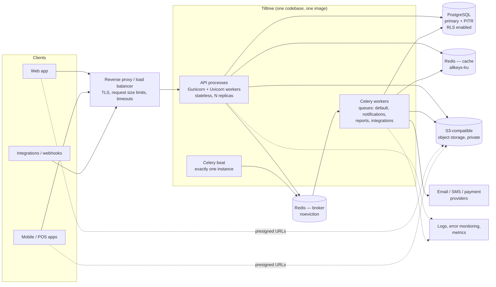

# 01 — System Architecture Overview

## 1. Shape of the system

One deployable Django codebase (a modular monolith) runs as three kinds of processes that share the same code and database:



Why these pieces and nothing else:

| Component | Purpose | Why not more |
|-----------|---------|--------------|
| PostgreSQL | System of record, tenant isolation (RLS), full-text and trigram search | No separate search engine or document store until Postgres measurably cannot cope |
| Redis (cache) | Permission/entitlement cache, rate-limit counters, short-lived state | — |
| Redis (broker) | Celery queue | A separate instance from the cache in production, because a cache must evict and a queue must never evict |
| Celery | Email/SMS, notifications, report generation, file processing, integrations, scheduled jobs | No Kafka or other event streaming; the transactional outbox + Celery covers current needs |
| Object storage | User files, exports, generated documents | Files never go in PostgreSQL or on local disk |
| Reverse proxy | TLS termination, body-size limits, timeouts, static files | A managed load balancer is acceptable in place of Nginx |

## 2. Layers inside the codebase

Each domain app has the same internal layers. Dependencies point downward only.

```
 api/            HTTP: DRF views, serializers (input + output), URL routes. Thin.
   │
 services.py     Commands: business operations, transaction boundaries, authorisation calls,
   │             audit + domain events. The only place that writes.
 selectors.py    Queries: read-side functions returning querysets / DTOs, tenant-scoped.
   │
 models.py       Persistence: fields, constraints, indexes. No business workflows.
   │
 common/         Framework-level utilities with no models and no business rules.
```

- Views parse input, call one service or selector, and serialize the result.
- Serializers validate shape and format only; they do not create related objects or enforce business rules.
- Services take explicit arguments (including the `RequestContext`; see below) and are callable from views, Celery tasks, management commands and tests alike.
- Signals are reserved for framework integration (e.g. cache invalidation). Business reactions use domain events.

## 3. Request lifecycle

```mermaid
sequenceDiagram
    participant C as Client
    participant MW as Middleware
    participant V as DRF view
    participant AZ as access.authorize()
    participant S as Service
    participant DB as PostgreSQL

    C->>MW: HTTPS request + Authorization + X-Organisation-ID
    MW->>MW: assign request_id, structured log context, size/timeout guards
    MW->>V: dispatch
    V->>V: authenticate (JWT → user + session; session revocation check, cached)
    V->>V: resolve tenant: active membership for (user, org)? else 404
    V->>DB: BEGIN; SELECT set_config('app.organisation_id', org, true)
    V->>AZ: permission + module entitlement + branch scope
    AZ-->>V: allow / deny (403)
    V->>S: call service with RequestContext
    S->>DB: tenant-scoped queries (manager filter + RLS)
    S->>DB: audit event + outbox event (same transaction)
    V->>DB: COMMIT
    V-->>C: response (+ X-Request-ID)
    Note over DB: after commit, outbox relay enqueues Celery tasks
```

`RequestContext` is a small immutable object (`user`, `membership`, `organisation_id`, `branch_ids`, `request_id`, `ip`, `user_agent`) built once per request. It is passed explicitly into services and also stored in a `contextvars.ContextVar` so logs, the tenant manager and the audit writer can read it. Explicit arguments are the source of truth; the context variable is a safety net and is never used to grant access.

Tenant resolution happens in the DRF layer, not in Django middleware, because JWT authentication runs inside DRF. Doing it in middleware would mean authenticating twice or trusting an unauthenticated header.

## 4. Assessment of the existing code

The repository already contains a working pharmacy point-of-sale MVP. It has good parts worth keeping:

- Stock logic in services (`receive_stock`, FEFO allocation with `select_for_update`, write-offs), with an append-only stock movement ledger.
- Cost captured per sale line, so profit is exact.
- `Decimal` for money, `TenantModel` base class, tests that include a tenant-isolation case.

It conflicts with the specification in ways that are expensive to fix later and cheap to fix now:

| Area | Current | Required |
|------|---------|----------|
| User model | `AbstractUser`, username login | Email login, phone support, UUID PK, verification |
| Primary keys | Sequential `BigAutoField` | UUIDs on externally exposed resources |
| Tenant | `Business` with `industry_pack` choices and `currency="UGX"` default | `Organisation` with country configuration, entitlements, settings |
| Defaults | `TIME_ZONE="Africa/Kampala"`, MTN/Airtel as fixed payment-method choices | UTC storage, per-country providers |
| Roles | Fixed `TextChoices` per membership, one role per user per business | Per-organisation roles, code-declared permissions, branch-scoped assignments |
| Tenant selection | Optional header; defaults to the user's only business | Always explicit |
| Isolation | Queryset filter in a view mixin only | Manager + service checks + RLS |
| Product model | Pharmacy-specific columns on the shared `Product` | Shared inventory model; pharmacy data in an industry module |
| Media | `ImageField` on local disk | Object storage via the documents domain |
| Errors, logging, health, Celery, Docker for app | Absent | Required |

Changing the user model and primary-key type after data exists means hand-written data migrations across every table. The recommendation ([ADR-0006](adr/0006-existing-mvp-disposition.md)) is to rebuild the foundation now with a fresh migration history and port the inventory/sales logic in Phase 4. **This assumes there is no production data in the current schema; please confirm.**
