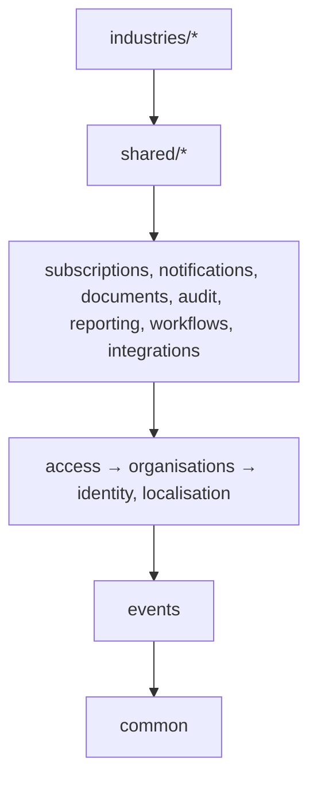

# 02 — Project Structure and Domain Boundaries

## 1. Refined layout

Only directories marked ✅ are created in Phase 1–3. Everything else is created in the phase that needs it, not earlier.

```
.
├── config/                         ✅ settings/{base,development,testing,production}.py, urls, asgi, wsgi, celery
├── common/                         ✅ framework-level code: NO models, NO business rules
│   ├── api/                        exception handler (problem+json), pagination, base views, throttles
│   ├── tenancy/                    tenant_context, TenantModel/TenantManager, EnableTenantRLS operation, TenantTask, deploy checks
│   ├── db/                         UUIDv7 ids, UUIDPrimaryKeyModel, TimeStampedModel (Money helpers in P3)
│   ├── observability/              structlog config, redaction, request-ID middleware, Celery propagation, Sentry scrubbing
│   ├── security/                   SSRF-safe HTTP client, upload validation helpers
│   └── health/                     liveness / readiness views
├── apps/
│   ├── identity/                   ✅ P1/P2 users, credentials, auth sessions, verification, MFA
│   ├── organisations/              ✅ P1 tenant root; P2 settings, settings, branches, departments, memberships, invitations
│   ├── access/                     ✅ P2 permissions registry, roles, role assignments, authorize(), platform staff, support grants
│   ├── localisation/               ✅ P3 countries, currencies, languages, timezones, country configuration, tax reference data
│   ├── subscriptions/              ✅ P3 modules, plans, entitlements, subscriptions, usage limits, billing records
│   ├── audit/                      ✅ P2 append-only audit events (needed by identity/access from day one)
│   ├── notifications/              ✅ P3 templates, preferences, deliveries, channel adapters (email, SMS, in-app)
│   ├── documents/                  ✅ P3 file metadata, object-storage references, upload/download flow
│   ├── events/                     ✅ P3 transactional outbox + relay (infrastructure for domain events)
│   ├── reporting/                     P4
│   ├── workflows/                     P4, only if two real use cases exist
│   ├── integrations/                  P4+ (payment providers, webhooks)
│   ├── shared/                        P4: people, customers, inventory, procurement, billing, finance
│   └── industries/                    P5: business, healthcare
├── tests/                          ✅ cross-cutting suites only: security/, performance/, migrations/
├── infrastructure/                 ✅ docker/, nginx/, scripts/, deployment/
├── docs/                           ✅ architecture/, adr/, runbooks/
├── Dockerfile, docker-compose.yml, pyproject.toml, uv.lock, .env.example, README.md
```

### Changes from the proposed structure, and why

| Proposed | Refined | Reason |
|----------|---------|--------|
| `apps/core` | Removed | "Core" becomes a dumping ground. Framework code goes in `common/` (no models); domain code goes in a named domain. |
| `memberships` + `permissions` as separate apps | `organisations` owns memberships; `access` owns roles/permissions | A role assignment references a membership and a membership check needs permissions, so splitting three ways creates a dependency cycle. Two apps with a one-way dependency (`access` → `organisations`) avoid it. |
| `countries` + `localisation` | One `localisation` app | Same reference data, same consumers. Tax can be extracted into its own app when a real tax engine is built. |
| `apps/events` (new) | Added | The outbox is shared infrastructure for domain events and has a model, so it cannot live in `common/`. |
| Top-level `tests/{unit,integration,api}` | Tests live in each app (`apps/x/tests/`); top-level `tests/` only for cross-cutting suites | Tests stay next to the code they cover and move with it if a domain is extracted. Test type is expressed with pytest markers (`unit`, `integration`, `api`, `security`, `performance`). |
| `requirements.txt` | `pyproject.toml` + `uv.lock` | Single source of dependencies with a lock file (spec §15). |

## 2. Domain responsibilities

| Domain | Owns | Does not own |
|--------|------|--------------|
| identity | User, password/credential lifecycle, email/phone verification, auth sessions + refresh tokens, MFA devices, login throttling state | Anything about organisations or roles |
| organisations | Organisation, OrganisationSettings, Branch, Department, organisation lifecycle (create, suspend, close) | Who belongs to it, permission evaluation |
| access | Permission and role-template registry (code-declared), Membership, Invitation, custom Role, RoleAssignment (membership × role × optional branch), `authorize()`, the tenant API base view, PlatformStaff, SupportAccessGrant, organisation onboarding | User accounts and sessions (asks `identity`) |
| localisation | Country, Currency, Language, CountryConfiguration, tax reference tables, formatting helpers | Organisation-specific choices (stored in OrganisationSettings) |
| subscriptions | Module and Feature catalogue, Plan, PlanEntitlement, Subscription, EntitlementOverride, usage counters, billing records for platform fees | Tenant's own invoicing to their customers (that is `shared/billing`) |
| audit | AuditEvent writing, querying, retention | Deciding what is auditable (each domain emits its own events) |
| notifications | Templates, preferences, delivery records, retries, channel adapters | Deciding when to notify (domains emit events; notification handlers subscribe) |
| documents | File metadata, storage keys, upload sessions, scan status, signed URLs | Business meaning of a file (owning domain links to `FileObject`) |
| events | Outbox table, relay task, handler registry | Business handlers (each domain registers its own) |

## 3. Dependency rules



1. A domain may import another domain **only through that domain's `public.py`** (service functions, selector functions, DTOs, exceptions). Importing another domain's `models.py` is allowed for one purpose: declaring a foreign key to a foundation entity (`Organisation`, `Branch`, `User`, `Membership`).
2. A domain never writes another domain's tables. It calls that domain's service.
3. Dependencies point down the diagram only. Peer domains on the same level do not import each other; they communicate through events.
4. `healthcare` and `business` never import each other.
5. Rules 1, 3 and 4 are enforced in CI with **import-linter** contracts in `pyproject.toml`, so they do not depend on code review.

### Enforced in CI

| Rule | Checked by |
|------|------------|
| A domain imports another domain only via its `public.py` | `tests/architecture/test_boundaries.py` (parses every import) |
| Domains depend downwards only: access → organisations → identity → audit | import-linter layers contract |
| Inside a domain: `api` → `services` → `models`, never upwards | import-linter layers contract (per domain) |
| The HTTP layer never writes to the database itself | `tests/architecture/test_boundaries.py` |
| `common` never imports `apps` or `config` | import-linter forbidden contract |
| Every tenant endpoint action declares its permission | `tests/security/test_cross_tenant_api.py` |

Phase 2 moved memberships and invitations from `organisations` to `access`. They are access decisions, and keeping them in `organisations` would have required `organisations` to depend on `access` (a cycle).

## 4. Cross-domain communication

| Need | Mechanism |
|------|-----------|
| Synchronous answer needed now ("is this user a member?") | Call the other domain's `public.py` function |
| Something happened and others may react ("membership revoked") | Domain event written to the **outbox table in the same transaction** as the change. After commit, the relay hands it to Celery; handlers run with the event's tenant context. |
| Within one domain, after commit side effects | `transaction.on_commit` |

The outbox exists so that "save the record" and "send the notification / sync the integration" cannot diverge: if the transaction rolls back, the event is never sent; if Celery is down, the event waits in the table. Handlers must be idempotent because delivery is at-least-once.

A generic in-process event bus with dozens of event types is not built up front. Events are added when a second domain needs to react.
