# 04 — Initial Data Model (Phases 1–3)

Industry and shared-operations tables (inventory, sales, patients) are designed in their own phases. This diagram covers the platform foundation only.

## 1. Entity relationship diagram

```mermaid
erDiagram
    USER ||--o{ AUTH_SESSION : "signs in via"
    USER ||--o{ MFA_DEVICE : has
    USER ||--o{ VERIFICATION_TOKEN : "verifies with"
    USER ||--o{ MEMBERSHIP : holds
    USER |o--o| PLATFORM_STAFF : "may be"

    COUNTRY }o--|| CURRENCY : "default currency"
    COUNTRY ||--|| COUNTRY_CONFIGURATION : configured_by
    COUNTRY }o--o{ LANGUAGE : supports
    COUNTRY ||--o{ TAX_RATE : defines

    ORGANISATION }o--|| COUNTRY : "registered in"
    ORGANISATION }o--|| CURRENCY : "base currency"
    ORGANISATION ||--|| ORGANISATION_SETTINGS : has
    ORGANISATION ||--o{ BRANCH : operates
    ORGANISATION ||--o{ DEPARTMENT : has
    ORGANISATION ||--o{ MEMBERSHIP : grants
    ORGANISATION ||--o{ INVITATION : sends
    ORGANISATION ||--o{ ROLE : defines
    ORGANISATION ||--o{ SUBSCRIPTION : has
    ORGANISATION ||--o{ ENTITLEMENT_OVERRIDE : has
    ORGANISATION ||--o{ AUDIT_EVENT : records
    ORGANISATION ||--o{ FILE_OBJECT : stores
    ORGANISATION ||--o{ SUPPORT_ACCESS_GRANT : authorises

    BRANCH }o--|| COUNTRY : "located in"
    DEPARTMENT }o--o| DEPARTMENT : parent
    DEPARTMENT }o--o| BRANCH : "within"

    MEMBERSHIP ||--o{ ROLE_ASSIGNMENT : has
    ROLE ||--o{ ROLE_ASSIGNMENT : "assigned through"
    BRANCH |o--o{ ROLE_ASSIGNMENT : "scopes (null = all)"

    PLAN ||--o{ PLAN_ENTITLEMENT : includes
    MODULE ||--o{ PLAN_ENTITLEMENT : "enabled by"
    SUBSCRIPTION }o--|| PLAN : "on"

    PLATFORM_STAFF ||--o{ SUPPORT_ACCESS_GRANT : requests

    NOTIFICATION_TEMPLATE ||--o{ NOTIFICATION : renders
    USER ||--o{ NOTIFICATION : receives
    NOTIFICATION ||--o{ NOTIFICATION_DELIVERY : "attempted via"

    USER {
        uuid id PK
        string email UK "stored lower-case"
        string phone_e164 "nullable, unique when set"
        string password_hash "Argon2id"
        bool is_active
        timestamptz email_verified_at
        timestamptz phone_verified_at
        string locale
        string timezone "nullable; falls back to org/branch"
        timestamptz created_at
    }
    AUTH_SESSION {
        uuid id PK
        uuid user_id FK
        bytes refresh_token_hash
        uuid token_family
        string device_label
        inet ip_created
        timestamptz last_used_at
        timestamptz expires_at
        timestamptz revoked_at
    }
    ORGANISATION {
        uuid id PK
        string name
        string slug UK
        string legal_name
        char2 country_code FK
        char3 base_currency FK
        string default_timezone "IANA"
        string default_locale
        string status "active|suspended|closed"
        string database_alias "default"
        timestamptz created_at
    }
    ORGANISATION_SETTINGS {
        uuid organisation_id PK
        string date_format_override
        int financial_year_start_month
        jsonb module_settings "schema-validated per module"
    }
    BRANCH {
        uuid id PK
        uuid organisation_id FK
        string code
        string name
        char2 country_code FK
        string timezone "IANA"
        bool is_active
    }
    DEPARTMENT {
        uuid id PK
        uuid organisation_id FK
        uuid branch_id FK "nullable"
        uuid parent_id FK "nullable"
        string name
    }
    MEMBERSHIP {
        uuid id PK
        uuid organisation_id FK
        uuid user_id FK
        string status "invited|active|suspended|left"
        uuid department_id FK "nullable"
        timestamptz joined_at
    }
    INVITATION {
        uuid id PK
        uuid organisation_id FK
        string email "lower-case"
        bytes token_hash
        uuid invited_by FK
        jsonb proposed_roles
        timestamptz expires_at
        timestamptz accepted_at
    }
    ROLE {
        uuid id PK
        uuid organisation_id FK "null = platform template"
        string key
        string name
        bool is_system "templates cannot be edited by tenants"
    }
    ROLE_ASSIGNMENT {
        uuid id PK
        uuid organisation_id FK
        uuid membership_id FK
        uuid role_id FK
        uuid branch_id FK "nullable = all branches"
        uuid granted_by FK
        timestamptz granted_at
    }
    PLATFORM_STAFF {
        uuid user_id PK
        string platform_role "super_admin|support_admin"
        bool mfa_required
    }
    SUPPORT_ACCESS_GRANT {
        uuid id PK
        uuid organisation_id FK
        uuid staff_user_id FK
        string scope "read_only_non_sensitive|..."
        string reason
        uuid approved_by FK "org owner, or null for break-glass"
        timestamptz starts_at
        timestamptz expires_at
        timestamptz revoked_at
    }
    COUNTRY {
        char2 code PK "ISO 3166-1 alpha-2"
        string name
        string calling_code
        char3 default_currency FK
        string default_timezone
        bool is_enabled
    }
    CURRENCY {
        char3 code PK "ISO 4217"
        int minor_units
        string symbol
    }
    COUNTRY_CONFIGURATION {
        char2 country_code PK
        string date_format
        string number_format
        jsonb address_format
        int financial_year_start_month
        jsonb payment_provider_codes
        jsonb regulatory_flags
        int version
    }
    TAX_RATE {
        uuid id PK
        char2 country_code FK
        string tax_code
        decimal rate
        date valid_from
        date valid_to
    }
    MODULE {
        string code PK "inventory, healthcare.clinical, ..."
        string name
        string kind "platform|shared|industry"
    }
    PLAN {
        uuid id PK
        string code UK
        bool is_public
    }
    PLAN_ENTITLEMENT {
        uuid plan_id FK
        string module_code FK
        jsonb limits "e.g. max_branches, max_users"
    }
    SUBSCRIPTION {
        uuid id PK
        uuid organisation_id FK
        uuid plan_id FK
        string status "trialing|active|past_due|cancelled"
        timestamptz current_period_start
        timestamptz current_period_end
    }
    ENTITLEMENT_OVERRIDE {
        uuid id PK
        uuid organisation_id FK
        string module_code FK
        bool enabled
        jsonb limits
        uuid granted_by FK
        string reason
    }
    AUDIT_EVENT {
        uuid id PK
        uuid organisation_id "nullable for platform events"
        uuid actor_user_id
        string actor_type "user|platform_staff|system"
        string action
        string resource_type
        string resource_id
        jsonb metadata "redacted"
        uuid request_id
        inet ip
        timestamptz occurred_at
    }
    FILE_OBJECT {
        uuid id PK
        uuid organisation_id FK
        string storage_key "org/<org_id>/..."
        string content_type
        bigint size_bytes
        string sha256
        string scan_status "pending|clean|infected"
        string classification "standard|sensitive|clinical"
        uuid uploaded_by FK
    }
    NOTIFICATION_TEMPLATE {
        uuid id PK
        uuid organisation_id "null = platform default"
        string key
        string channel "email|sms|in_app"
        string locale
        text body
    }
    NOTIFICATION {
        uuid id PK
        uuid organisation_id FK
        uuid recipient_user_id FK
        string template_key
        timestamptz read_at
    }
    NOTIFICATION_DELIVERY {
        uuid id PK
        uuid notification_id FK
        string channel
        string provider
        string status "queued|sent|delivered|failed"
        int attempts
        string provider_message_id
    }
```

Not shown: `OUTBOX_EVENT` (events app), `IDEMPOTENCY_RECORD` (common API), `USAGE_COUNTER` (subscriptions), `NOTIFICATION_PREFERENCE`, `LANGUAGE`.

## 2. Ownership and isolation

| Table | Category | `organisation_id` | RLS | Notes |
|-------|----------|-------------------|-----|-------|
| User, AuthSession, MFADevice, VerificationToken | User-owned | — | No | Accessed by identity services only |
| PlatformStaff | Platform | — | No | Writable only by super admins; changes audited |
| Country, Currency, Language, CountryConfiguration, TaxRate | Global reference | — | No | Cached; versioned |
| Module, Plan, PlanEntitlement | Global reference | — | No | Phase 3 |
| Organisation | Tenant root | = `id` | No | Users must see the names of organisations they belong to before choosing one, so access is by membership check. It holds only name, slug, status and defaults; sensitive organisation data lives in RLS tables. |
| OrganisationSettings, Branch, Department, Role (tenant), RoleAssignment, Subscription, EntitlementOverride, FileObject, Notification, NotificationDelivery, SupportAccessGrant | Tenant | required | Yes | |
| Role with `organisation_id = null` | Platform template | — | Policy allows null | System role templates, read-only to tenants |
| NotificationTemplate | Mixed | nullable | Yes, `org = ctx OR org IS NULL` | Tenant overrides fall back to platform default |
| Membership | Bridge | required | Yes, read: `org = ctx OR user_id = app.user_id`; write: `org = ctx` | Lets users list their own organisations |
| SupportAccessGrant | Bridge | required | Yes, read: `org = ctx OR staff_user_id = app.user_id`; write: `org = ctx` | Staff list their own grants |
| Role, RoleAssignment, Invitation, OrganisationSettings, Branch, Department | Tenant | required | Yes (`tenant_isolation`) | |
| AuditEvent | Tenant (nullable for platform) | nullable | Yes | Append-only: `tillfree_app` has `INSERT, SELECT` only. Monthly partitions. |
| OutboxEvent | Tenant | nullable | Yes | Relay reads with platform alias |
| IdempotencyRecord | Tenant | required | Yes | Expires after 24h |

### Phase 2 implementation notes

- **Permissions are not a table.** They are declared in each app's `permissions.py` and collected at startup (`apps/access/registry.py`). Built-in role templates (Owner, Administrator, Manager, Staff, and module templates later) also live in code. Only organisation-defined custom roles are rows (`access_role.permissions` is an array of codes). A permission removed from code is ignored, never granted.
- `RoleAssignment` and `Invitation` reference either a template key or a custom role; a check constraint enforces exactly one.
- `AuditEvent` read policy: the organisation's events, plus a user's own account events (no organisation) under `user_context`. No UPDATE or DELETE policy exists, so the log is append-only even for the table owner.
- Identity tables (`identity_authsession`, `identity_refreshtoken`, `identity_onetimetoken`, `identity_totpdevice`, `identity_recoverycode`) are user-owned and never accessed through an organisation context. Tokens are stored only as SHA-256 hashes; TOTP secrets are encrypted with Fernet (`FIELD_ENCRYPTION_KEYS`).

### Phase 3 tables

| Table | Category | RLS | Notes |
|-------|----------|-----|-------|
| Currency, Country, CountryConfiguration, TaxRate | Global reference | No | Platform-managed (admin); disabled, never deleted. Organisation/branch country and currency codes are validated against them in services (no cross-domain foreign key). |
| Module, Plan, PlanEntitlement, PlanPrice | Global catalogue | No | Prices per currency and interval; none seeded. |
| Subscription, EntitlementOverride, SubscriptionInvoice | Tenant | Yes | At most one current subscription per organisation (partial unique index). |
| NotificationTemplate, NotificationPreference, Notification, NotificationDelivery | Tenant | Yes | `Notification.dedupe_key` makes event-driven notifications idempotent. |
| FileObject (`documents_file`) | Tenant | Yes | Bytes live in object storage under `org/<organisation id>/files/<file id>`. |
| OutboxEvent, ProcessedEvent | Internal | No | Identifiers only; see ADR-0007. |

## 3. Conventions

| Topic | Rule |
|-------|------|
| Primary keys | UUIDv7 (time-ordered: good index locality, no enumeration, safe to move between databases). [ADR-0003](adr/0003-uuidv7-primary-keys.md) |
| Reference data keys | Natural codes where a standard exists (`UG`, `UGX`, `inventory.stock.adjust`) |
| Timestamps | `timestamptz`, stored in UTC; `created_at`, `updated_at` on mutable tables |
| Money | Two columns: `<name>_amount NUMERIC(19,4)` + `<name>_currency CHAR(3)`. Rounded to the currency's minor units at business boundaries. Never `float`. |
| Tenant indexes | Every tenant table's indexes lead with `organisation_id` (e.g. `(organisation_id, created_at)`, `(organisation_id, branch_id, status)`) |
| Uniqueness | Tenant-scoped (`UNIQUE (organisation_id, code)`), never global unless genuinely global |
| Composite FK safety | Where a child references a tenant parent, a check constraint or composite FK `(organisation_id, parent_id)` prevents cross-tenant references at the database level, used for high-risk relations (role assignment → role/branch) |
| Choices | `TextChoices` for stable internal states; reference tables for anything a country or tenant can extend (payment methods, tax codes) |
| JSONB | Only for configuration, provider metadata and audit metadata, validated against a schema on write. Never for data that is queried relationally. |
| Deletion | Hard delete by default. Soft delete (`archived_at`) only where history must remain referenceable (branches, roles, products). Personal-data erasure via pseudonymisation where audit or financial retention applies. |
| Migrations | Backwards-compatible (expand → migrate → contract). `makemigrations --check` in CI. Large-table indexes `CONCURRENTLY`. |
