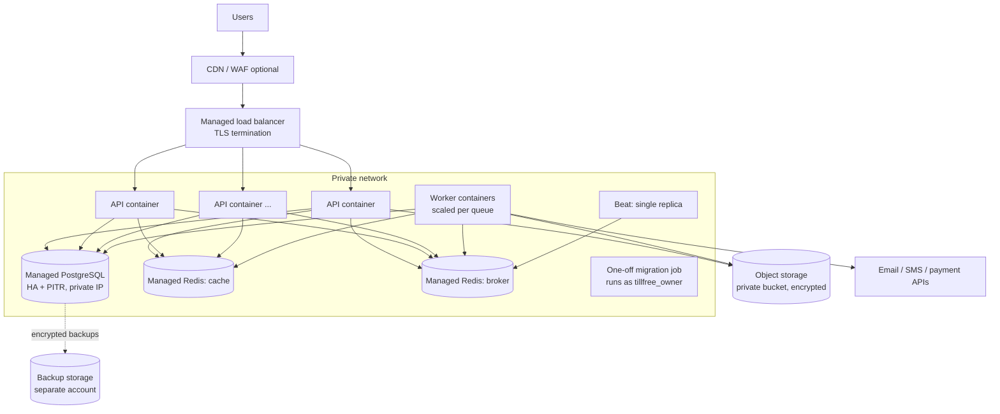

# 09 — Infrastructure, Performance and Operations

## 1. Technology versions (to be re-verified at the start of Phase 1)

| Component | Choice | Reason |
|-----------|--------|--------|
| Python | 3.14 (verified: all dependencies install and pass tests) | Broad library support |
| Django | 5.2 LTS (security support to April 2028); plan the upgrade to the next LTS after its release | Stability over newest features |
| DRF, drf-spectacular, django-filter, django-cors-headers | Current stable | Maintained, standard |
| PostgreSQL | 17 minimum; 18 where the managed provider supports it | RLS, `NULLS NOT DISTINCT`, performance |
| psycopg | 3.x with Django's built-in connection pool | No extra pooler process at first |
| Redis | 7.x (or Valkey) | |
| Celery | 5.x | |
| Server | Gunicorn + `uvicorn-worker` (ASGI) | Spec requirement. `uvicorn.workers.UvicornWorker` is deprecated in favour of the `uvicorn-worker` package. |
| Packaging | `uv` with `pyproject.toml` + `uv.lock` | Fast, reproducible, one file |
| Quality | Ruff (lint + format), mypy with `django-stubs` / `djangorestframework-stubs`, import-linter, pytest + pytest-django + factory-boy | |
| Observability | structlog (JSON), Sentry SDK (or self-hosted GlitchTip, which is Sentry-compatible), Prometheus metrics via `django-prometheus` when a metrics stack exists | |
| Storage | `django-storages` + boto3 against any S3-compatible service; MinIO in local development | |
| Phones / i18n | `phonenumbers`, Babel | |

A note on ASGI: the codebase is written with synchronous views (the ORM and DRF are synchronous). Under ASGI, Django runs sync views in a thread pool, which costs some throughput compared with WSGI. We deploy ASGI as specified because it keeps the door open for WebSockets/server-sent events (live notifications, POS sync), keep `wsgi.py` working, and benchmark both in Phase 1. If ASGI is measurably slower and nothing needs async, the decision can be revisited with data.

## 2. Local development (Docker Compose)

Services: `postgres` (database and roles created by `infrastructure/db/create_roles.sql`), `redis`, `migrate` (one-off job, runs as `tillfree_owner`), `api` (runserver with reload, runs as `tillfree_app`), `worker`, `beat`. `mailpit` (catches email) is added in Phase 2 and `minio` (object storage) in Phase 3, when something uses them. `Makefile` targets: `install`, `db-roles`, `migrate`, `run`, `test`, `lint`, `typecheck`, `imports`, `check`, `ci`, `up`.

The development database uses the same RLS roles as production, so isolation bugs show up locally. SQLite is no longer supported (it has no RLS and different semantics).

## 3. Production deployment

Vendor-neutral: everything runs as containers from one image, configured only through environment variables and a secrets manager.

Recommendation: start on a **managed container platform** (e.g. AWS ECS Fargate, Google Cloud Run, Azure Container Apps, or a smaller provider) with managed PostgreSQL and Redis. **Do not start with Kubernetes**: it adds a large operational burden for a small team without a current need. The container-based design allows a move to Kubernetes later.

The hosting region is an open decision because of data-residency obligations (see roadmap).

### Release process
1. CI builds and scans the image, runs tests.
2. Migration job runs (as `tillfree_owner`) — migrations must be backwards-compatible with the currently running code.
3. Rolling deploy of API and workers; readiness check gates traffic.
4. Rollback = redeploy the previous image. Because migrations are expand-only during a release, the previous image still works. Destructive "contract" migrations ship in a later release.

## 4. Performance targets (initial proposals, to be validated)

| Metric | Target |
|--------|--------|
| p95 latency, simple tenant reads | ≤ 200 ms server time |
| p95 latency, standard writes (e.g. a sale with 10 lines) | ≤ 400 ms |
| Error rate | < 0.5% 5xx |
| Queries per request | ≤ 10 on list endpoints, constant in page size (no N+1) |
| Background email/SMS dispatch | 95% within 60 s |

Measured with Locust scenarios in `tests/performance/` against a production-like dataset (e.g. 1,000 organisations, 1 million stock movements). Targets are revisited after the first real traffic.

## 5. Database performance

- Query-count assertions in API tests (`django_assert_max_num_queries`) to catch N+1 regressions.
- Every tenant index leads with `organisation_id`; `EXPLAIN` reviewed for new list endpoints.
- `statement_timeout` (e.g. 5 s for API role, longer for report workers via a separate setting), `idle_in_transaction_session_timeout`.
- Connection pooling via Django's psycopg pool; PgBouncer in transaction mode when replica counts grow (set `DISABLE_SERVER_SIDE_CURSORS=True`). Both are safe with transaction-local tenant context.
- Heavy reporting moves to a read replica when needed; precomputed daily aggregates for dashboards rather than live scans of transaction tables.
- Large append-only tables (audit, stock movements, notifications) partitioned by month when they reach a size that warrants it.

## 6. Caching

| What | Key | Invalidation |
|------|-----|-------------|
| Country config, currencies, permissions registry | global, versioned | On change / deploy |
| Effective permissions per membership | `t:<org>:perm:<membership>:v<version>` | Version bump on role/assignment/entitlement change |
| Entitlements per org | `t:<org>:ent:v<version>` | Version bump on subscription/override change |
| Membership lookup | `t:<org>:mem:<user>` | Delete on membership change |
| Revoked session IDs | `auth:revoked:<sid>` | TTL = access-token lifetime |

Tenant keys are produced only by `tenant_cache_key()`. Authenticated responses are `Cache-Control: private` (or `no-store` for sensitive data); shared HTTP caches never store tenant responses.

## 7. Background processing

- Queues: `default`, `notifications`, `reports`, `integrations`, `files`. Separate worker deployments so a slow report cannot delay password-reset emails.
- `acks_late=True`, `task_reject_on_worker_lost=True`, explicit time limits, retries with exponential backoff and jitter for transient errors only.
- Tasks are idempotent (idempotency keys or state checks). Arguments are IDs, never model instances or personal data.
- Failed tasks after final retry are recorded (dead-letter table + Sentry alert).
- Beat schedule defined in code; exactly one beat replica.

## 8. Observability

- **Logs:** JSON via structlog to stdout; fields: `timestamp, level, event, request_id, organisation_id, user_id, path, status, duration_ms`. Request ID propagated into Celery task headers and outbound HTTP calls.
- **Errors:** Sentry-compatible SDK with PII scrubbing, release tagging, Celery integration.
- **Metrics:** request rate/latency/error by endpoint, queue depth and task latency per queue, DB pool usage. Alerts on error rate, latency, queue backlog, failed backups.
- **Health:**
  - `/health/live/` — process is up; no dependency checks (used for restarts).
  - `/health/ready/` — DB and Redis reachable, migrations applied; returns only `ok`/`unavailable` (details logged, not exposed). Used by the load balancer.

## 8a. Scheduled jobs and external services (Phase 3)

| Job (Celery beat) | Every | Purpose |
|-------------------|-------|---------|
| `relay_outbox` | 30 s | Backstop for event delivery (normally immediate after commit) |
| `renew_due_subscriptions` | 6 h | One task per organisation: trial → active, new periods, invoices, past-due |
| `purge_stale_uploads` | 24 h | Remove uploads that were started but never completed |

External services: S3-compatible object storage (bucket private, CORS allowing the web app's origin for presigned POSTs), ClamAV daemon (`clamd`) for scanning, SMTP, and Africa's Talking for SMS. Local development needs none of them: files are kept in memory, scanning is skipped, email prints to the console and SMS is recorded in memory.

## 9. Backups and recovery

| Item | Proposal |
|------|----------|
| PostgreSQL | Managed PITR (≥ 14 days) + daily encrypted logical dump to storage in a separate account (≥ 35 days) |
| Object storage | Versioning + lifecycle rules; replication to a second region when residency rules allow |
| Initial RPO / RTO | 15 minutes / 4 hours (to be agreed with the business) |
| Restore testing | Quarterly restore into an isolated environment, timed and recorded in `docs/runbooks/` |
| Graceful shutdown | Gunicorn graceful timeout ≥ load-balancer drain; Celery warm shutdown with `acks_late` so in-flight tasks are re-delivered |

## 10. CI/CD

Pipeline on every push/PR: Ruff → mypy → import-linter → `makemigrations --check` → pytest (with PostgreSQL + Redis services, using the RLS roles) with coverage threshold → OpenAPI schema diff → `pip-audit` → Docker build + image scan. Main branch deploys to staging automatically; production deploys are manual approvals of a tested image.
